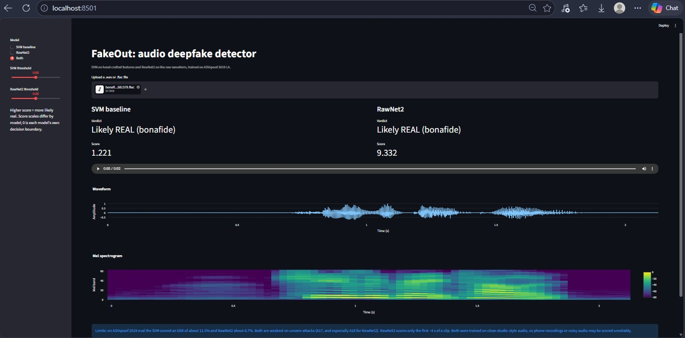
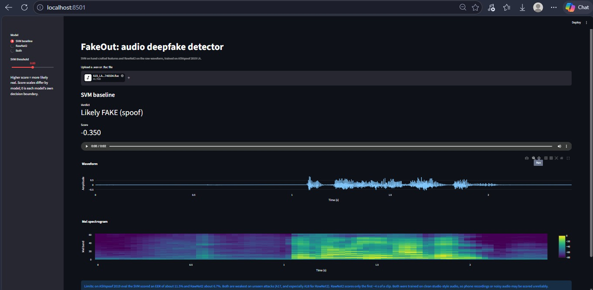
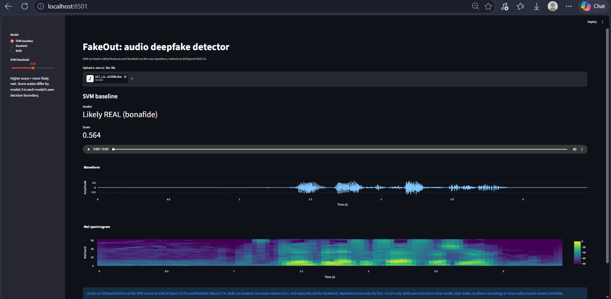

# FakeOut: audio deepfake detection (ASVspoof 2019 LA)

Flow: protocol files -> pick clips -> extract features -> train SVM -> EER + min t-DCF

- `core.py`  sampling, features, model, metrics
- `run.py`   `python run.py` (raw audio) or `python run.py --trim` (silence trimmed)
- `analysis/` one-off checks, e.g. the leading-silence shortcut

Results (eval, sampled: 2000 bonafide + 300 per attack):
| run  | dev EER | eval EER | min t-DCF |
|------|---------|----------|-----------|
| raw  | 0.78%   | 11.54%   | 0.2705    |
| trim | 2.80%   | 29.24%   | 0.5812    |

## Attack-diversity experiment (non-standard protocol, not an official ASVspoof result)

`python -m analysis.attack_diversity --seed N` (N = 0, 1, 2). Extra clips from some unseen attack
types (speaker-disjoint, with matched bonafide) are added to training, and the model is tested on
the other attack types. The control adds the same number of clips from already-known attack types.

Pooled EER on held-out attacks:
| seed | test group | baseline | +control | +new attack types |
|------|------------|----------|----------|-------------------|
| 0 | G2 | 9.94%  | 10.29% | 8.00%  |
| 0 | G1 | 17.81% | 17.69% | 13.00% |
| 1 | G2 | 12.21% | 12.24% | 11.23% |
| 1 | G1 | 13.20% | 14.26% | 10.42% |
| 2 | G2 | 15.84% | 16.55% | 11.60% |
| 2 | G1 | 10.77% | 11.53% | 8.29%  |

New attack types helped in 6/6 tables (about -2.9 points on average); the control did not.
A17 (VC) stays hard (28.6-35.6% EER even with extra attack types).

## Demo

Run locally: `streamlit run app.py`. The sidebar offers the SVM baseline, RawNet2, or both side by side.

RawNet2 needs PyTorch and the checkpoint: download `rawnet2_best.pt` from the
[latest Release](https://github.com/ANKP-SUdo/fake-voice-detection/releases) into `models/`
and run `pip install torch`. Without them the app runs the SVM only.

| Eval clip | SVM | RawNet2 |
|---|---|---|
| Real speech | 1.221, REAL | 9.332, REAL |
| Attack A19 (same algorithm as a training attack) | -0.350, FAKE | -6.095, FAKE |
| Attack A17 (unseen attack) | 0.564, REAL (missed) | -9.823, FAKE |

  

Three clips are illustrations, not evidence. The eval-set metrics are in the results table below,
and RawNet2 still misses some A17 clips (A17 EER 10.3%).

## Results (ASVspoof 2019 LA eval)

The SVM was scored on a seeded, stratified sample of the eval set (5,900 clips: 2,000 bonafide + 300 per attack) and trained on 5,160 clips.
RawNet2 was trained on all 25,380 training clips and scored on all 71,237 eval trials. `analysis/compare_models.py` also scores RawNet2 on the SVM's exact sample.

| Model | Eval set | EER | min t-DCF |
|---|---|---|---|
| SVM + hand-crafted features | 5,900-clip sample | 11.54% | 0.270 |
| RawNet2 | same 5,900-clip sample | 6.35% | 0.159 |
| RawNet2 | full 71,237 trials | 6.66% | 0.162 |

Per-attack EER (%), same 5,900-clip sample; RawNet2 on the full eval in the last column:

| Attack | SVM | RawNet2 | RawNet2 (full) |
|---|---|---|---|
| A07 | 0.00 | 2.32 | 2.46 |
| A08 | 0.66 | 5.63 | 6.90 |
| A09 | 1.00 | 0.68 | 0.55 |
| A10 | 3.63 | 2.32 | 2.63 |
| A11 | 2.58 | 2.32 | 2.21 |
| A12 | 16.63 | 2.63 | 2.79 |
| A13 | 2.71 | 0.97 | 0.70 |
| A14 | 3.02 | 1.07 | 1.07 |
| A15 | 11.05 | 2.71 | 2.32 |
| A16 | 0.61 | 1.71 | 1.52 |
| A17 | 35.34 | 8.24 | 10.28 |
| A18 | 20.68 | 28.49 | 27.63 |
| A19 | 1.12 | 2.05 | 2.57 |

Observations: RawNet2 fixes the attacks the SVM fails most (A12, A15, A17), but is worse than the SVM on A18,
which is the weakest result for both models; the cause is not yet investigated. Each attack has only 300 spoof clips in the
sample, so differences of a point or two per attack are within noise.

Caveats:
- Model class and training-set size are confounded (the SVM used a smaller training subset).
- Single run, seed 0; the RawNet2 checkpoint was chosen by dev EER (best dev EER 0.70% at epoch 17).
- RawNet2 scores only the first 64,600 samples (about 4 s) of each clip.

## Next
- Add RawNet2 as a second model in the demo.
- Future work: AASIST and self-supervised front-ends, data augmentation, and a second seed.