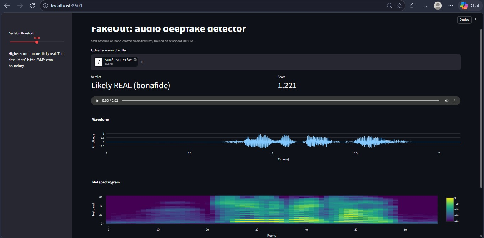
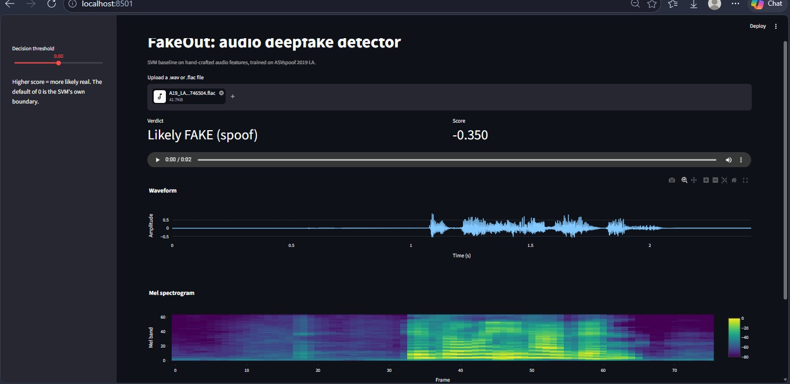
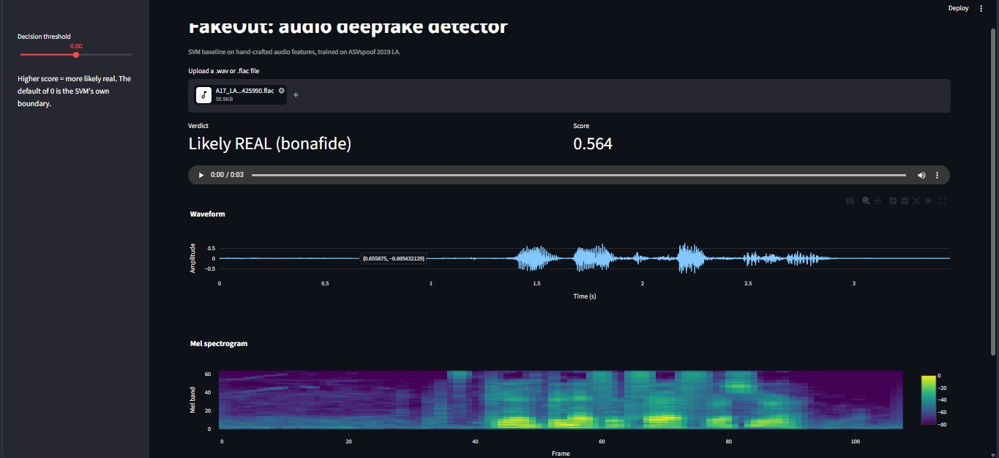

# FakeOut: audio deepfake detection (ASVspoof 2019 LA)

Flow: protocol files -> pick clips -> extract features -> train SVM -> EER + min t-DCF

- `core.py`  sampling, features, model, metrics
- `run.py`   `python run.py` (raw audio) or `python run.py --trim` (silence trimmed)
- `analysis/` one-off checks, e.g. the leading-silence shortcut

Results (eval, sampled: 2000 bonafide + 300 per attack):
| run  | dev EER | eval EER | min t-DCF |
|------|---------|----------|-----------|
| raw  | 0.78%   | 11.54%   | 0.2705    |
| trim | 2.80%   | 29.24%   | 0.5812    |

## Attack-diversity experiment (non-standard protocol, not an official ASVspoof result)

`python -m analysis.attack_diversity --seed N` (N = 0, 1, 2). Extra clips from some unseen attack
types (speaker-disjoint, with matched bonafide) are added to training, and the model is tested on
the other attack types. The control adds the same number of clips from already-known attack types.

Pooled EER on held-out attacks:
| seed | test group | baseline | +control | +new attack types |
|------|------------|----------|----------|-------------------|
| 0 | G2 | 9.94%  | 10.29% | 8.00%  |
| 0 | G1 | 17.81% | 17.69% | 13.00% |
| 1 | G2 | 12.21% | 12.24% | 11.23% |
| 1 | G1 | 13.20% | 14.26% | 10.42% |
| 2 | G2 | 15.84% | 16.55% | 11.60% |
| 2 | G1 | 10.77% | 11.53% | 8.29%  |

New attack types helped in 6/6 tables (about -2.9 points on average); the control did not.
A17 (VC) stays hard (28.6-35.6% EER even with extra attack types).

## Demo

Run locally: `streamlit run app.py`

| Real speech | Seen attack (A19) | Unseen attack (A17) |
|---|---|---|
|  |  |  |
| score 1.221, REAL | score -0.350, FAKE | score 0.564, REAL (missed) |

The A17 miss illustrates the generalization gap seen in the eval metrics (EER 11.54%).
Next step: RawNet2 on raw waveforms.